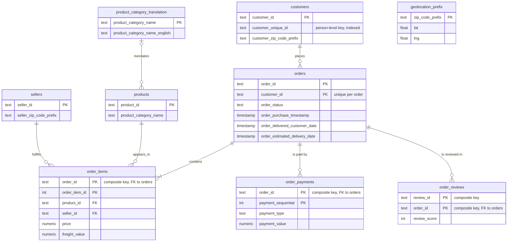

# E-Commerce SQL Analytics (Olist)

A SQL-first analysis of the Olist Brazilian e-commerce marketplace dataset:
99,441 orders from 2016 to 2018 across nine relational tables. All analytical
work happens in PostgreSQL, in seven commented queries built on window
functions and CTEs. Python only loads the CSVs, executes the .sql files,
tests the results, and renders the charts and the HTML report. The finished
report is committed at [output/report.html](output/report.html), so you can
read the results without running anything.

## Key findings

All figures are query output on delivered orders from January 2017 through
August 2018 (the analysis window; the sparse edge months of 2016 and late
2018 are excluded).

- R$ 15.37 million of delivered revenue across 96,211 orders and 93,104
  customers in 20 months.
- The best month was November 2017 with R$ 1.15 million, up 53.6 percent
  on October; its highest-revenue day was November 24, Black Friday.
  Monthly revenue then plateaued around R$ 1.0 to 1.13 million through
  2018.
- Repeat purchase is rare: 3.0 percent of customers ordered more than once
  in the window, and on average 0.48 percent of a cohort orders again in the
  month after the first purchase. No cohort cell after month 0 exceeds 0.72
  percent.
- The "Recent high value" and "Lapsed high value" RFM segments (customers
  who bought once and spent in the top two quintiles) hold 30.1 percent of
  customers and 55.6 percent of revenue.
- Delivery timing tracks review scores closely: orders 8 or more days late
  average a 1.70 review score with 69.8 percent 1-star reviews, versus 4.32
  and 6.5 percent for orders 8 or more days early. The report describes this
  as an association and makes no causal claim.
- Seller revenue is concentrated: the top 1 percent of sellers (30 of 2,945)
  earn 25.5 percent of revenue; the top 20 percent earn 81.5 percent.

## The queries

One file per business question, each with a header comment stating the
question, tables, technique, and assumptions.

| File | Question | SQL techniques |
|---|---|---|
| [01_monthly_revenue_trend.sql](sql/queries/01_monthly_revenue_trend.sql) | Monthly revenue, orders, average order value, month-over-month change | CTE, `LAG()` |
| [02_cohort_retention.sql](sql/queries/02_cohort_retention.sql) | Share of each first-purchase cohort ordering again, by month offset | CTEs, window aggregates, `generate_series` grid, NULL for unobservable cells |
| [03_rfm_segmentation.sql](sql/queries/03_rfm_segmentation.sql) | Recency, frequency, monetary segments and their revenue share | `NTILE(5)`, CASE mapping, grouped window shares |
| [04_rolling_revenue.sql](sql/queries/04_rolling_revenue.sql) | Daily revenue with a 30-day rolling sum and a running total | Date spine, explicit `ROWS BETWEEN` frames |
| [05_top_categories.sql](sql/queries/05_top_categories.sql) | Top 3 revenue categories per quarter | `RANK()` with a comment on RANK vs DENSE_RANK vs ROW_NUMBER, multi-table joins |
| [06_delivery_delay_reviews.sql](sql/queries/06_delivery_delay_reviews.sql) | Review score by delivery delay bucket | Fan-out-safe order-level joins, CASE buckets |
| [07_seller_concentration.sql](sql/queries/07_seller_concentration.sql) | Revenue share of the top 1, 5, 20 percent of sellers | Cumulative window sums, `VALUES` tier list |

Shared definitions live in [sql/schema/03_derived.sql](sql/schema/03_derived.sql):
the analysis window, the revenue definition (one view every query reads), the
one-review-per-order rule, and the geolocation deduplication.

## Schema



Zip code prefixes link customers and sellers to `geolocation_prefix` (built
from the raw 1,000,163-row geolocation table), without an enforced foreign
key: 278 customer prefixes have no geolocation row.

## Setup and run

Prerequisites: Docker (Desktop on Windows/macOS), Python 3.14 (the version
this was built and tested on), and the dataset (next section).

Windows (PowerShell):

```powershell
copy .env.example .env     # then edit the password in .env
docker compose up -d
python -m venv .venv
.venv\Scripts\Activate.ps1
pip install -r requirements.txt
python scripts\load_data.py
python scripts\run_analysis.py
python -m pytest
```

macOS / Linux:

```bash
cp .env.example .env       # then edit the password in .env
docker compose up -d
python3 -m venv .venv
source .venv/bin/activate
pip install -r requirements.txt
python scripts/load_data.py
python scripts/run_analysis.py
python -m pytest
```

`load_data.py` drops and recreates the schema on every run, so it is safe to
repeat and always produces the same database. `run_analysis.py` writes query
results to `output/results/`, charts to `output/charts/`, and the report to
`output/report.html`.

## Data source

[Olist Brazilian E-Commerce Public Dataset](https://www.kaggle.com/datasets/olistbr/brazilian-ecommerce)
on Kaggle, license CC BY-NC-SA 4.0. The data is not redistributed in this
repository: download the zip from Kaggle and unzip the nine CSVs into
`data/raw/` before running `load_data.py`.

## Tests

`pytest` runs 45 tests against the Docker database, in three groups:

- Data quality after load: row counts match the CSVs record for record,
  primary keys are unique, no orphaned foreign keys, timestamps in plausible
  ranges.
- Correctness: retention, RFM, and rolling revenue also run against small
  hand-made fixture datasets in a separate schema, where the expected output
  was worked out by hand and is asserted exactly.
- Reconciliation on the real data: monthly revenue sums to total revenue,
  cohort sizes sum to the distinct customer count, RFM segment counts sum to
  the customer count, the cumulative total on the last day equals total
  revenue, and item revenue reconciles with payment totals within 0.1
  percent.

## Data quality notes and limitations

Everything below was verified against the loaded data; the traps are also
pinned down by tests so a regression would fail the suite.

- `customer_id` is unique per order (99,441 values for 99,441 orders). The
  person-level key is `customer_unique_id` (96,096 distinct values), and
  every customer-level analysis uses it. Computing retention on
  `customer_id` would return exactly zero.
- Repeat purchasing is rare (3.0 percent of customers in the
  window). The retention and RFM results report this as it is; the RFM query
  documents why frequency quintiles would be meaningless here and scores
  frequency with a direct rule instead of `NTILE`.
- The dataset edges are sparse: 2016-09 has 4 orders, 2016-11 has none,
  2016-12 has 1, 2018-09 has 16, 2018-10 has 4. The analysis window is
  2017-01-01 to 2018-08-31, stored in a one-row table
  (`olist.analysis_window`) that every query reads, so it is applied
  consistently. 267 delivered orders fall outside the window and are
  excluded. Cohort cells after August 2018 are unobservable and are reported
  as NULL, which keeps them distinct from an observed zero.
- `geolocation` has 1,000,163 rows across 19,015 zip prefixes and is unusable
  as a join key as shipped. It is loaded raw, then deduplicated into
  `geolocation_prefix` (average coordinates, most frequent city and state).
  No query joins the raw table.
- `order_reviews` has 814 duplicate `review_id` rows and 547 orders with more
  than one review; the pair (review_id, order_id) is unique and is the
  primary key. The view `order_reviews_clean` keeps one review per order:
  the latest by answer timestamp, tie-broken by creation date, then
  review_id.
- 2,961 orders have multiple payment rows and 9,803 have multiple item rows.
  Items are aggregated to order level inside the `order_revenue` view before
  any other join, so queries touching payments or reviews cannot double
  count.
- Revenue is defined once, in `order_revenue`: item price plus freight for
  orders with status 'delivered' inside the window. Payments recorded for the
  same orders total 0.018 percent more than item revenue (vouchers and
  rounding); the reconciliation test holds the gap under 0.1 percent. One
  delivered order (`bfbd0f9bdef84302105ad712db648a6c`) has no payment rows at
  all.
- Product category names are Portuguese; queries report the English names
  from the translation table. Two categories (`pc_gamer`,
  `portateis_cozinha_e_preparadores_de_alimentos`) have no translation and
  keep their Portuguese names; 610 products have no category and group as
  'unknown'.
- Other findings from profiling: 8 delivered orders lack a delivery
  timestamp (excluded from the delay analysis, which states its row counts);
  all orders missing item rows have non-delivered statuses, so the revenue
  definition loses no delivered orders; four product measurement columns are
  misspelled in the source CSVs (`product_name_lenght`) and are renamed in
  the schema.
- Limitations: 20 months of data from one marketplace, so seasonal
  conclusions rest on at most two observations of any month. The delivery
  delay analysis is an association; late delivery is not randomly assigned.
  Review coverage is incomplete (95,560 of 96,211 window orders have a
  review and a delivery date).

## Performance

[docs/performance.md](docs/performance.md) has `EXPLAIN ANALYZE` notes for
the two heaviest queries, including a measured before and after for the one
index that changes a timing (about 13 percent on the review deduplication)
and notes on the indexes that change nothing at this data size.

## Repository layout

```
docker-compose.yml       PostgreSQL 16, credentials from .env
sql/schema/              tables, constraints, indexes, derived views
sql/queries/             the seven analyses, one file each
src/                     db helpers, chart rendering, report template
scripts/load_data.py     builds and fills the database (idempotent)
scripts/run_analysis.py  runs every query, writes results, charts, report
tests/                   pytest suite (45 tests)
docs/performance.md      EXPLAIN ANALYZE notes
output/                  committed report, charts, and query results
data/raw/                gitignored; place the Kaggle CSVs here
```
